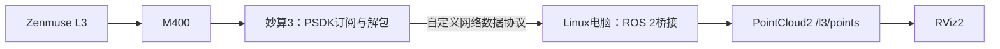

# 妙算 3接入 L3真实点云的开发流程

更新：2026-11-04（Asia/Shanghai）。目标：M400 挂载 Zenmuse L3，在本机 ROS 2发布真实 `sensor_msgs/msg/PointCloud2`，并在 RViz2中交互查看。

本文是取得妙算 3后的实施与验收计划，**不是已经完成的点云驱动使用说明**。当前本机 Ubuntu 22.04 / ROS 2 Humble的 RGB → ROS Image → RViz链路已实机验证；真实 L3 XYZ尚未取得，妙算 3尚未接入。本次提交整理开发流程，不代表机载端程序已经实现。

## 1. 设备与软件准备

| 项目 | 准备内容 | 完成标志 |
| --- | --- | --- |
| 现有设备 | M400、L3、RC Plus 2、Linux电脑 | 遥控器能够识别准确的L3型号和挂载位置 |
| 新增机载设备 | DJI 妙算 3、匹配M400的安装件及E-Port V2连接线 | 妙算上线，电脑可以SSH登录 |
| 地面网络 | 优先电脑接M400调参USB口的虚拟网络；也可通过妙算的USB扩展坞及以太网接入同一局域网 | 电脑与妙算双向通信正常 |
| 开发应用 | 在DJI开发者中心创建并激活妙算PSDK应用，取得App ID、App Key、App Advanced License等应用信息 | 专用程序初始化成功，凭据仅存本地 |
| 版本配套 | 使用支持L3的PSDK，核对飞机、遥控器、L3、妙算固件 | 记录实际版本及选定PSDK提交 |
| 电脑显示 | 现有ROS 2 Humble与RViz2；增加真实点云接收/发布节点 | `/l3/points`发布真实PointCloud2 |

PSDK 3.14.0新增L3支持；本次官网查阅版本为3.17.0。实施时以所选SDK版本的固件兼容表为准，不自动升级设备。妙算原生环境与电脑环境分开管理，不为统一ROS版本重刷妙算系统。[PSDK版本说明](https://developer.dji.com/doc/payload-sdk-tutorial/en/)、[妙算开发流程](https://developer.dji.com/doc/payload-sdk-tutorial/cn/manifold-quick-start/quick-demo.html)

官网的M400标准高级功能路线使用妙算 3。第三方计算平台另有申请PSDK高级权限的入口，是否批准及是否覆盖L3订阅需DJI确认；普通开发板不等于已经获得这些权限。[开放能力表](https://developer.dji.com/doc/payload-sdk-tutorial/en/development-preparation/development-platform-overview/open-capability-list.html)

## 2. 先完成地面有线链路



妙算接M400的E-Port V2，官方支持E1/E2/E3并推荐E3；保留L3现有正确接线。电脑通过**飞机调参USB口**的虚拟网卡访问妙算，不是把L3直接接成USB点云设备。官方提供的妙算地址为E1：`192.168.42.120`、E2：`192.168.42.130`、E3：`192.168.42.140`，以实际端口和网络状态核实。妙算自身USB-C口不支持直接连接电脑；使用该口联网时应通过受支持的扩展坞/以太网设备。[连接与登录](https://developer.dji.com/doc/payload-sdk-tutorial/cn/manifold-quick-start/quick-demo.html)、[硬件能力](https://developer.dji.com/doc/payload-sdk-tutorial/cn/manifold-quick-start/manifold-platform-capabilities/hardware-capabilities.html)

首轮只检查设备上线、SSH、网络收发和版本信息，不运行综合示例菜单。通信程序先用明确标为合成数据的本地样本验证分包、断线和缓冲上限；这只能证明软件链路，不能替代实机取点验收。

## 3. 在妙算上实现专用L3采集程序

1. 基于固定版本的官方PSDK妙算示例建立独立程序，只保留初始化、相机识别、点云录制状态、点云接收和必要清理。
2. 枚举负载并精确确认L3型号与挂载位置。本机MSDK曾观察到`PORT_1`，不能直接当成PSDK相同枚举值写死。
3. 在取得本次采集授权后，检查原始录制状态；由程序启动的录制必须设置独立停止计时并确认停止。不得接管或停止用户原本就在进行的录制。
4. 按官方`DjiTest_CameraManagerSubscribePointCloud()`的专用路径取数：录制开始后，按实际负载端口连接MOP通道49154、UNRELIABLE，循环接收有效字节。49154是DJI通道ID，不是电脑TCP端口。
5. 收到数据后先验证包结构及连续性，再交给网络发送线程；断开、异常或时间到时清理MOP，并停止本次程序启动的录制。

官方L3 FAQ说明实时点云流在点云录制期间提供；PSDK教程明确支持L2/L3实时三维点云订阅，当前教程要求关闭Pilot 2。即使使用Pilot安装了应用，实际订阅时也不能假定Pilot可以并发占用该流，可通过SSH启动专用程序。[L3 FAQ](https://enterprise.dji.com/zenmuse-l3/faq)、[点云订阅教程](https://developer.dji.com/doc/payload-sdk-tutorial/cn/function-overview/advanced-function/basic-camera-management.html)

参考源码：[PSDK固定提交的点云示例](https://github.com/dji-sdk/Payload-SDK/blob/8b7d0ca607b9153ae3ec34db99028a5fbeea421f/samples/sample_c/module_sample/camera_manager/test_camera_manager.c)。抽取专用逻辑，不直接运行包含云台、相机其他控制或飞行功能的综合示例。

## 4. 先证明收到的是真实XYZ

固定版本PSDK头文件定义了28字节包头，以及每点16字节的XYZ、强度和RGB结构；必须按实际收到的协议验证，不能把图像帧或LDRT文件直接套入这个结构。[官方结构定义](https://github.com/dji-sdk/Payload-SDK/blob/8b7d0ca607b9153ae3ec34db99028a5fbeea421f/psdk_lib/include/dji_camera_manager.h)

| 检查 | 处理要求 |
| --- | --- |
| 帧边界与长度 | 检查标记、头部长度、有效载荷长度、点记录对齐；支持分片或多包，不读取缓冲尾部 |
| 连续数据 | 记录包序号、时间字段、点数、字节数、断流和丢包统计；不能只看建连返回值 |
| 点有效性 | 拒绝非有限坐标和损坏记录，检查XYZ范围是否与实际场景一致 |
| 坐标语义 | 核对轴向、单位、原点、时间单位；当前这些语义尚未全部完成验证，不默认所有XYZ都是机体坐标或米 |
| 校验与资源限制 | 明确CRC算法及是否校验；限制包大小、队列长度和内存，避免网络阻塞SDK接收 |

此前遥控器MSDK诊断中，49154连接成功但有界录制测试读取为0；这既不是成功取点，也不是“无妙算必然失败”的证明。下载过一个真实LDRT文件，但未得到有效XYZ；完整文件调用未明确文档化的SDK解码方法曾不返回，该尝试已终止并移除自动调用。后续不要继续猜偏移或对任意数据盲调该解码器。

## 5. 传到电脑并发布PointCloud2

首版建议机载端保持小型PSDK/C++采集程序，电脑继续使用已有ROS 2 Humble环境，避免同时解决机载ROS部署问题。下面是待实现的协议与节点约定，不是当前已有功能：

- 机载程序通过专用TCP连接发送明确分帧的数据，头部包含协议版本、载荷长度、序号、点数、时间字段和坐标定义；与现有JPEG协议及其端口分开。
- 电脑接收器校验长度与字段，处理分片、断开及重连，使用有界队列。机载发送拥堵时采用明确的丢帧策略并上报计数，不无限积压。
- 发布话题拟定为`/l3/points`，类型`PointCloud2`；字段至少包含`x/y/z`，按收到的数据增加`intensity`和`rgb`。正确设置字段类型、offset、point_step、row_step、width、height及大小端。
- 只有核对数据坐标系后才设置对应`frame_id`；NED等坐标转换须按确认的源坐标定义实现。不伪造map/odom定位或相机外参。
- 无硬件时间同步时，使用并明确标注电脑接收时间；保留源时间用于后续核对，不能直接用不同设备的单调时钟相减计算延迟。
- 发布与RViz订阅采用匹配的QoS，建议从SensorDataQoS开始；RViz使用PointCloud2显示项，Fixed Frame与实际发布坐标系保持一致。

单位/坐标原点未确认时可保留原始包做离线分析，但不能把未知单位默认为米并宣称完成标准PointCloud2验收。验收期间禁止用演示点、屏幕像素反投影或旧数据伪装为实时L3点云。

## 6. 分阶段验收与故障定位

| 阶段 | 通过条件 | 失败后排查位置 |
| --- | --- | --- |
| A：设备与网络 | 妙算上线、应用初始化成功、电脑收发测试正常 | 接线、网络路由、凭据、SDK/固件配套 |
| B：L3原始数据 | 确认真实L3来源，连续收到非空包，有有效XYZ和序号/时间变化 | 录制状态、Pilot占用、端口寻址、PSDK订阅条件 |
| C：电脑接收 | 与机载端发送统计匹配，断线可恢复，缓冲不增长 | 自定义协议、分片重组、网络吞吐及队列 |
| D：ROS与RViz | 正确PointCloud2布局；RViz显示真实场景并可旋转观察，数据持续更新 | 字段、单位、坐标系、QoS、Fixed Frame |
| E：停止与留档 | 本次录制确认停止、连接关闭；保存脱敏统计和版本信息 | 独立停止机制、异常清理与状态确认 |

完成节点后可在电脑检查：

```bash
source /opt/ros/humble/setup.bash
ros2 topic info /l3/points -v
ros2 topic hz /l3/points
ros2 topic bw /l3/points
rviz2
```

以上命令只用于已部署节点的验收，不会自行创建真实点云话题。验收记录应包含观测时长、包/点数量、实际更新率、丢弃/无效包统计、停止结果与RViz观察结论，不承诺尚未测出的带宽或延迟。真实包、截图、设备标识和密钥仅留在本地忽略目录。

## 7. 有线通过后，再实现经遥控器转发

```text
L3 → M400 → 妙算3接收XYZ
                 ↓ 自定义MOP通道
             遥控器MSDK App
                 ↓ USB / ADB reverse
             电脑 → PointCloud2 → RViz
```

官方支持妙算与遥控器MSDK的MOP互联；上述是据此设计的待开发转发方案，不是已验收的L3端到端功能。[互联能力](https://developer.dji.com/doc/payload-sdk-tutorial/cn/manifold-quick-start/psdk-capabilities-overview.html)

妙算同时承担L3订阅客户端和自定义转发端。新通道须与L3订阅通道分开配置、避免冲突；不盲扫通道。需要同步实现Android二进制接收、USB发送及电脑解包，并验证有效吞吐、分片、丢包、重连和端到端延迟。图传视频清晰不代表这个自定义数据通道带宽已达标。采样或压缩必须明确记录，不能把抽稀结果当成原始全量测绘点云。

## 8. 当前操作边界与剩余确认

本项目始终只做地面L3取数，不启电机、不起飞、不移动云台，不用M400机身避障雷达代替L3。用户此前批准的一次及后续三次约20秒录制均已执行并确认停止，**这些授权已经用完**。接入妙算后的新录制须取得针对新测试的授权；安装、查版本、编译及离线测试不需要因此暂停。

L3订阅文档列出了录制及Pilot关闭要求，没有明确承诺“室内、地面、未进行航向标定”能持续提供XYZ；也不能据此认定必须起飞。妙算到位前，应向DJI确认这一工况及其所需初始化条件，要求针对L3负载回答，不套用机身感知雷达的起飞前提。

实时L3数据用于现场预览，其精度不等同于后处理测绘成果。本阶段目标是可靠取得真实点云并正确显示，硬件同步、绝对定位及高精度建图另行验收。[官方精度说明](https://enterprise.dji.com/zenmuse-l3/faq)

下一次接续从第1、2节开始：核对妙算型号与接线、建立SSH和网络，然后开发专用PSDK取点程序；在阶段B取得有效XYZ以前，不把系统标记为“点云已接通”。
