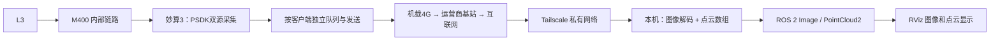

# L3 点云与可见光实时传输：MVP 开发方案

更新：2026-11-17（Asia/Shanghai）。本方案替代本文件先前的多阶段扩展设计，作为当前实现顺序。

当前验收目标（2026-11-17用户收窄范围）：通过妙算3取得一路真实L3可见光H.264和一路真实XYZ预览点云，经M400机载4G传到本机，在现有ROS 2 Humble / RViz中同时显示并持续刷新。多电脑接收能力保留，不作为本轮验收前提。全程地面验证，沿用仓库禁止电机、起飞、飞控和云台运动的范围。

## 1. 先固定能力依据

采集、设备识别与机载网络能力以用户提供的 DJI PSDK 中文教程、API 及匹配版本官方头文件为依据。TCP 分发、电脑解码和 Tailscale 是本项目的工程选择，不属于 DJI 提供的现成双流服务。

| 能力 | DJI 官方依据 | 本项目采用方式 |
| --- | --- | --- |
| 精确识别设备 | [相机管理][camera]、`DjiCameraManager_GetCameraType()` | 查询实际挂载位置，必须确认为 `DJI_CAMERA_TYPE_L3` |
| 可见光视频 | [Liveview][liveview]、[固定版本头文件][liveview-header] | 复用已实测的 `DEFAULT` H.264 回调，电脑端解码 |
| L3 实时点云 | [相机管理][camera]、[固定点云示例][point-sample] | 按实际 L3 mount 连接 MOP `49154 / UNRELIABLE` |
| 机载4G上网 | [机载网络][internet]、[系统功能][system-features] | 飞机安装 DJI 增强图传模块、开通对应流量包并确认4G正常 |
| 自定义业务传输 | [PSDK 功能介绍][capabilities] | 妙算应用使用机载4G访问自定义网络服务 |

点云录制期间才提供 L3 实时点云；当前订阅教程要求退出 Pilot 2。该数据是实时预览点云，不能当成存储卡的全量测绘成果。[相机管理][camera]、[L3 FAQ][l3-faq]

当前 SDK 不作为依据承诺两路测绘相机视频、动态编码码率、SEI 曝光时间或硬件同步。第一版只交付已经有接口依据的一路可见光与一路预览点云。

## 2. 当前基线与采集前置阻塞

- 仓库基线：`5da04b4`；PSDK 3.18.0：`f3938d881e1628fc9a12e1b982b77060b9006311`。
- 妙算：Ubuntu 20.04.6 / AArch64 / GCC 9.4；M400 已读到 19.01.10.03。
- 妙算目前接 E2；L3 在 PSDK 负载位置 1。启动时仍须重新精确识别，不能将两种端口编号混用。
- 已验证短时可见光：8秒得到 518416 bytes H.264，解码为 1920×1080。尚无真实 XYZ 或持续双流验收。
- 2026-11-17 用户已安装4G模块。妙算经机载默认出口实际完成DNS解析与DJI/Tailscale HTTPS访问；尚未验收双流业务吞吐。USB管理链路出现过中断，不继续投入 Wi-Fi 配网。

**真实采集当前受 PSDK 内部内存错误阻塞。** [2026-11-16 测试报告](TEST_REPORT_2026-11-16.md)记录 ASan 捕获 `DjiMopChannel_UsbBulkSendData` 从28字节源读取4096字节。问题发生于运行期后台路径，不能通过跳过 DeInit 当作修复。

先获得并核验适用于本组合的修复库/官方处理方案，再验证无录制视频的持续运行和正常退出。此前不启用点云录制入口。协议、分发器和电脑解码可用合成数据并行开发，但结果只能记为离线软件验证。

## 3. MVP 网络架构

网络采用M400机载4G经运营商基站接入互联网，妙算3与本机通过Tailscale组网。此前已确认的多电脑分发能力保留；本轮仅验收本机接收与RViz显示，不再等待第二台电脑。



运营商基站提供蜂窝网络承载；本机分别建立视频与点云连接。本机不运行DJI SDK，也不经遥控器转发业务数据。

开发阶段先将相同端口绑定到 USB 管理网络完成有线验证；4G阶段再绑定实际可用的 Tailnet 地址。这样采集代码和电脑解码接口保持一致。

DJI 文档确认的是互联网和自定义网络通信能力，没有承诺公网固定地址、入站端口、Tailscale、TUN权限或业务带宽。Tailscale先单独核验标准组网方式与两台电脑的连通性，未通过前不声称4G多路方案可运行。它是待验证的项目依赖，不扩展成多种穿透/代理框架。

## 4. 核心代码只保留三个职责

保持现有 `onboard/`、`pc_viewer/` 目录，不迁移工程、不创建空模块。

| 职责 | 文件与开发内容 | 完成标准 |
| --- | --- | --- |
| 采集 | 复用 `onboard/l3_rgb_probe.c`、`l3_pointcloud_psdk.c`；初始化沿用 `metadata_inspect.c` 的独立流程 | SDK数据交给明确的字节回调，采集线程不直接操作网络 |
| 分发 | 已实现 `onboard/l3_stream.c/.h` | 两个独立TCP端口、每流最多两客户端、独立有界队列、发送与停止 |
| 接收与显示 | 已实现 `pc_viewer/l3_stream.py`，点云复用 `l3_points.py`；待补ROS桥接 | 连续得到BGR及XYZ/强度/RGB数组，发布Image和PointCloud2，由本机RViz显示 |

上述核心源码与SDK无关集成测试已完成。`metadata_inspect.c --stream` 已接入两种采集回调，控制器新增独立的持续读取模式；原20秒探测模式保持不变。SDK修复门槛仍默认关闭，尚未执行真实双流采集。

### 4.1 采集模块

- 视频保留一次 SDK Start/Stop 生命周期，网络客户端的加入或断线不触发反复初始化相机。
- H.264 回调的数据仅在调用期间有效；及时复制入有界缓冲。一个回调不是一帧，也不是一个 NAL。
- 点云复用精确 L3 验证、MOP 地址映射和包布局检查；给持续接收增加明确的停止信号与独立读取线程。
- 当前点云接口是短时探测接口。SDK Connect/Recv/Stop 没有可依赖的公开硬取消参数，不能把“循环30包”或设置很大包数当成持续服务或时间保证。
- 录制命令沿用现有明确入口与停止机制；连接电脑、重连网络不自动开启或停止用户已有录制。
- 首次20秒取点验收后，持续采集入口再支持显式60秒/5分钟测试时长并保留独立Stop；现有20秒短时控制器不直接充当持续服务，也不通过增大收包次数替代时长控制。

传输层只需要两个发布入口，接收借用缓冲并负责复制，不引入统一传感器对象模型：

```text
publish_h264(context, bytes, length)
publish_points(context, packet, length)
```

### 4.2 分发模块

首版固定两条TCP数据通道，复用已经存在的点包封装：

| 项目端口 | 数据 | 格式 |
| --- | --- | --- |
| 9101/TCP | 真实点云 | `L3P1` + 大端 uint32 长度 + 一份完整原始 DJI 点包 |
| 9102/TCP | 可见光 | 按源顺序发送 H.264 字节，不添加自定义头、不转 JPEG |

49154是DJI内部MOP通道，与上述TCP端口不同。旧点云诊断工具默认9010；用于MVP时显式指定9101。`L3P1`仍是项目自己的封装，不是DJI协议名。首版保留原包，暂不重新定义点云二进制格式。

每流最多两个客户端，共四条业务连接。连接的生命周期由电脑订阅决定；所有客户端共享同一份相机/点云采集，不重复订阅 SDK。

最小队列约定：

- 每客户端视频排队上限先设2 MiB、点云1 MiB，另限制记录数；实际速率确定后调整常量，不引入动态配置中心。
- 发送线程从队列取数据，SDK回调只复制入队；网络慢时不阻塞采集及另一台电脑。
- 点云仅丢弃完整、尚未发送的旧包；已部分发送的包失败后关闭该连接，避免后续解包错位。
- 视频不任意丢弃回调字节；队列满或发送超过预算时断开该慢客户端。
- 视频新连接先发送缓存的 SPS/PPS，再从完整 IDR 访问单元的起始边界接入，避免接入多slice图像的中间。用小型增量 Annex-B 解析处理跨回调起始码，不实现编码器或完整 H.264 解码器。
- 视频实际封装、SPS/PPS和IDR行为须用真实 SDK 流确认；“等到可解码起点”属于验收条件，不能只用TCP建连成功代替。

仅统计收到/发出的字节和点包、解码帧数、队列丢弃、慢客户端断开及重连次数。队列限制和正确分帧属于实时传输本身，不另起通用可靠性框架。

### 4.3 电脑接收模块

- 视频：使用现成 H.264 解码库增量解码，得到 `uint8 H×W×3` BGR 数组；OpenCV显示和算法读取共用该输出。
- 点云：复用现有 `parse_packet()`，输出XYZ、强度和RGB；保留源序号、时间原值及本机接收时间。
- 电脑端处理TCP拆包和断线；协议尺寸与包长上限沿用现有校验。
- 当前接收器能显示OpenCV窗口及输出点数组；尚未为这条PSDK/4G新链路发布ROS消息。
- 本轮需补最小ROS桥接：`/l3/camera/image_raw`发布`sensor_msgs/msg/Image`（bgr8），`/l3/points`发布`PointCloud2`，在现有Humble/RViz显示。RViz图像使用Image显示项，点云使用PointCloud2显示项。
- 点云单位和坐标确认后使用明确的局部frame；本轮不要求SLAM、地图定位、图像点云投影或硬件同步。未知源时间保留原值，ROS时间暂用明确标注的本机接收时间。

DJI固定头定义20字节点云头、8字节CRC和16字节点记录。当前尚须核对真实包边界、坐标单位/原点、时间单位和CRC算法；不将未知时间重命名为曝光时间，也不把未经核对的XYZ直接标成米或世界坐标。[点云结构][point-header]

## 5. 4G接入只做必要步骤

1. 用户安装与 M400 配套的 DJI 增强图传模块，开通对应流量包，确认飞机4G正常。
2. 在妙算上验证DNS、HTTPS和实际业务连接。增强图传开关状态、遥控器有网或出现4G图标，都不能单独证明妙算业务通道可用。
3. 沿用飞机内部网络；官方说明负载网络访问在满足4G前提时默认启用。不安装AT拨号程序，不改`onboard`的IP/DHCP。
4. 当前账号无CAP_NET_ADMIN，两端已准备官方Tailscale用户态模式。妙算通过Serve转发到回环9101/9102；本机接收器显式使用`--socks5 127.0.0.1:1055`。两端登录同一Tailnet后再验收实际数据通道。
5. 测量本机接收真实双流的实际码率、刷新与队列情况，完成RViz显示；不以第二台电脑或新增传输协议作为前置条件。

网络工程选择与DJI能力分开记账：DJI文档提供网络出口能力依据，实际出口仍由本项目验证；本项目实现业务连接、双流分发及电脑解码。Tailscale访问范围限制在参与联调的设备与业务端口，不新建一套应用账号/控制协议。

### 上行与流量计算

本轮验收仅一个接收端。保留的多客户端能力会重复占用机载上行；设视频实际码率为 `Rv`，点云码率为 `Rp`：

```text
总业务上行 ≈ 客户端数量 × (Rv + Rp) + TCP/组网开销
点云封装字节/秒 ≈ 16 × 点数/秒 + 36 × 点包数/秒
流量 GB/小时 ≈ 平均总上行 Mbps × 0.45
```

36字节由28字节DJI包前缀和8字节L3P1封装组成，不含TCP/网络开销。这是计算方法，不是L3实测速率。已有8秒视频样本也不能作为持续带宽指标。

## 6. 按这个顺序实现与验收

| 顺序 | 工作 | 通过条件 |
| --- | --- | --- |
| 0 | SDK修复与数据源核验 | 可见光持续取流并正常退出；随后有界点云采集收到真实有效XYZ，停止结果可确认 |
| 1 | 核心传输离线实现，可与0并行 | 合成点包与有效合成H.264可经TCP连续接收；拆包、解码和停止通过 |
| 2 | USB有线单电脑双流 | 同时收到真实点云和可见光，持续60秒以上；输出两路数组与实际速率，无无限积压 |
| 3 | 本机ROS桥接 | 接收器输出转换为Image/PointCloud2，RViz显示项、编码和局部frame正确；合成数据仅用于软件验证 |
| 4 | 安装4G后的网络验证 | 妙算机载出口、Tailnet及两条业务TCP均可用，记录实际连接类型和上行 |
| 5 | 4G本机RViz验收 | 本机经4G实际收到来自L3的可见光及XYZ，RViz同时持续刷新图像与点云，保留来源及速率统计 |

60秒可用于首轮持续观察，不是DJI保证的稳定性指标。本轮最终验收以本机RViz中的真实双流为准；合成数据、旧录像和点云预览视频不能替代真实XYZ。全程保持地面测试。

最先写分发器和电脑增量解码；采集端只接入现有回调与必要的持续读取。每项代码以真实数据或有效合成流证明能工作，不用空目录、占位话题或假点云填满模块。

ROS桥接与RViz已纳入当前必需工作；SRT/RTMP、全量遥测、同步标定、自动转码、自启动、录像管理和Web控制台仍不前置。

## 7. 已实现代码、运行与实测边界

已交付分发器、持续点云读取及停止控制、SDK双流入口、Python连续接收与解码。SDK双流入口`--stream`会启动点云录制，仍受`L3_ENABLE_POINT_RECORDING_PROBE=OFF`默认门槛限制；拒绝发生于读取私有配置、网络监听与SDK初始化之前。

本机SDK无关编译与验证：

```bash
cmake -S onboard -B build/transport -DL3_BUILD_PSDK_APP=OFF -DCMAKE_BUILD_TYPE=Release
cmake --build build/transport -j2
cd build/transport && ctest --output-on-failure
```

在仓库根目录准备Python环境后：

```bash
python3 -m venv .venv
.venv/bin/python -m pip install -r requirements.txt
.venv/bin/python pc_viewer/test_l3_stream.py
.venv/bin/python pc_viewer/test_stream_integration.py
```

电脑接收命令（USB路径；实际采集程序尚未启用）：

```bash
.venv/bin/python pc_viewer/l3_stream.py --host 192.168.42.130 --seconds 60
```

Tailnet接收命令（先替换实际妙算Tailnet地址，并完成两端授权与Serve配置）：

```bash
.venv/bin/python pc_viewer/l3_stream.py --host MANIFOLD_TAILNET_IP --socks5 127.0.0.1:1055 --seconds 60
```

妙算程序仅Tailnet使用时绑定`127.0.0.1`；同时做USB测试时显式绑定`0.0.0.0`。`192.168.42.130`是飞机转发地址，不是妙算本机接口地址，不能直接绑定它。

本机和妙算已安装并启动经官方SHA256核对的Tailscale 1.104.7用户态进程，已授权到同一Tailnet；没有修改系统路由或配置开机自启。二进制位于`~/.local/opt/tailscale-1.104.7/`，私有状态与socket位于`~/.local/state/l3-tailscale/`。妙算Serve9101/9102已转发到本机回环对应端口，本机SOCKS5为1055；账号、授权链接和节点身份不写入仓库。用户态模式与TCP转发依据[官方userspace说明](https://tailscale.com/docs/concepts/userspace-networking)及[官方Serve说明](https://tailscale.com/docs/reference/tailscale-cli/serve)，不是DJI SDK能力。

已验证：新接收器8项测试、C到两个Python接收器的有效合成H.264/BGR与点云字段集成、断开单客户端后另一端继续及重连解码、旧图像/点云协议。C核心在本机及妙算原生严格GCC、ASan/UBSan/泄漏检测通过；最终源码在妙算原生编译链接，13项CTest（分发、持续reader、控制器11场景）全部通过。默认`--stream`门槛实际验证在配置读取和SDK初始化前返回2。

实际机载出口上的Tailnet验证已通过：两端口各两连接的合成TCP回传逐字节一致；随后在妙算运行不链接SDK的C回放器，以有效合成H.264和合成点包经Serve/4G送往本机两个接收实例，实际解码、XYZ/强度/RGB字段、单端断开隔离与重连解码均通过。两实例在同一台电脑，不替代两台物理电脑验收。该测试是小流量链路验证，不是实际L3码率的带宽测试。

本轮路径探测为DERP_RELAY，往返延迟721/313/354ms；未验证DIRECT或低延迟指标。USB管理中断后已通过Tailnet SSH完成最终原生编译和测试。VNC服务卡住的问题另行修复，不进入业务代码。

妙算开发文件在`/open_app/workspaces/dji/l3-dev/mvp-20261117`；本次尚未初始化SDK或开启录制。现存SDK库hash仍与已复现内存错误的版本一致。真实XYZ、真实双流、当前接收器的ROS桥接及4G本机RViz验收仍待完成；不再以两台物理电脑验收作为前置。合成测试不替代这些结果。

[camera]: https://developer.dji.com/doc/payload-sdk-tutorial/cn/function-overview/advanced-function/basic-camera-management.html
[liveview]: https://developer.dji.com/doc/payload-sdk-tutorial/cn/function-overview/advanced-function/liveview.html
[liveview-header]: https://github.com/dji-sdk/Payload-SDK/blob/f3938d881e1628fc9a12e1b982b77060b9006311/psdk_lib/include/dji_liveview.h
[point-sample]: https://github.com/dji-sdk/Payload-SDK/blob/f3938d881e1628fc9a12e1b982b77060b9006311/samples/sample_c/module_sample/camera_manager/test_camera_manager.c
[point-header]: https://github.com/dji-sdk/Payload-SDK/blob/f3938d881e1628fc9a12e1b982b77060b9006311/psdk_lib/include/dji_camera_manager.h
[internet]: https://developer.dji.com/doc/payload-sdk-tutorial/cn/advanced-function/access-internet.html
[system-features]: https://developer.dji.com/doc/payload-sdk-tutorial/cn/manifold-quick-start/manifold-platform-capabilities/system-features.html
[capabilities]: https://developer.dji.com/doc/payload-sdk-tutorial/cn/manifold-quick-start/psdk-capabilities-overview.html
[l3-faq]: https://enterprise.dji.com/zenmuse-l3/faq
