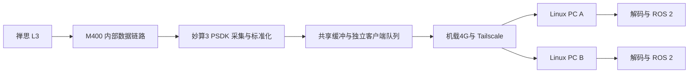

# M400 与禅思 L3 空地多模态数据传输开发方案

更新日期：2026-11-16。项目名称：M400-L3 Remote Multimodal Streaming System。

本项目通过妙算3采集 L3 的实时预览点云与可见光视频，利用机载互联网和 Tailscale，将数据分发给一台或多台 Linux PC。地面端提供可供算法使用的图像数组、点云和 ROS 2 消息。

当前先完成真实数据源验证，再完成有线单机回传、4G 组网、多客户端和工程化。**现阶段所有设备验收均在地面进行，严禁启电机、起飞、飞控、对频和云台运动。** 原讨论稿中的飞行验收不属于本次开发授权。

同日测试更新：已短时取得 L3 DEFAULT H.264，并解码确认 1920×1080 可见光预览；尚未实现持续实时窗口或真实点云。PSDK 3.18.0 内部越界读取已由 ASan 复现，实际点云录制未启动，先解决 SDK 内存问题再继续。详见[首次测试记录](TEST_REPORT_2026-11-16.md)。下文方案仍有效，表中较早的“未取流”状态以本条及测试记录为准。

## 1 项目目标与范围

第一版必须实现：

1. 妙算3通过官方 PSDK 获取真实 L3 点云及至少一路经过解码确认的可见光视频。
2. 业务数据不经过遥控器中继；地面 PC 不需要运行 DJI SDK。
3. 优先使用 M400 的 DJI Cellular Dongle 2 机载4G，经 Tailscale 向授权 PC 提供服务，不自建业务转发服务器。
4. 至少两台 PC 可独立订阅；单客户端断线或变慢，不阻塞采集和其他客户端。
5. 地面端可读取 RGB/BGR 图像与 XYZ 数据，并发布真实 `Image`、`PointCloud2`。
6. 保留源端时间信息、有效性和数据来源，为后续融合算法提供依据。

后续扩展包括遥测、可靠的时间映射、标定、多机管理和算法接入。双测绘相机的两路实时视频、L3 原始测绘照片、完整 IMU/POS、硬件同步和地图定位，分别以接口和实测结果决定，不并入首版的既成能力。

“不自建业务服务器”允许使用 Tailscale 的协调及必要中继服务；不等于所有连接都能直连或完全不经过第三方基础设施。遥控器可以用于设备状态查看和必要设置，但不承担本方案业务数据转发；关闭 Pilot 2 也不等于关闭遥控器。

## 2 当前已经验证的基础

| 项目 | 2026-11-16 的状态 |
| --- | --- |
| 硬件接入 | M400 已连接 L3 和妙算3；妙算改接 E2 后亮灯，Pilot 2 可见设备卡片 |
| 开发连接 | 当前 Windows PC 接 M400 调参 USB；SSH `dji@192.168.42.130` 已成功 |
| 妙算系统 | Ubuntu 20.04.6，AArch64，内核 5.10.192-tegra，L4T 35.5.0 |
| 编译工具 | GCC/G++ 9.4.0，CMake 3.16.3，Make 4.2.1，Python 3.8.10 |
| SDK 基线 | PSDK 3.18.0，提交 `f3938d881e1628fc9a12e1b982b77060b9006311` |
| 应用身份 | 已准备妙算专用 PSDK 凭据；实机 `DjiCore_Init` 和 `ApplicationStart` 均成功，凭据仅存私有文件 |
| 飞机型号及版本 | 只读确认 M400，飞机版本 19.01.10.03 |
| L3 身份 | PSDK 负载挂载位置 1，精确类型 `DJI_CAMERA_TYPE_L3`，数值 117 |
| 最小程序 | 独立元数据程序原生编译、链接成功，实机约 8.99 秒正常退出并完成清理 |
| 离线软件验证 | 图像与点云协议测试通过；独立 socket 的 UDP/TCP 回环、超时、截断和 EOF 测试通过 |
| 实际采集 | 本轮未运行 PSDK 视频或点云取流，未启动录制；不得将型号查询成功写成数据已接通 |

E2 是妙算的物理接入位置，PSDK 负载位置 1 是 L3 的查询结果，两者不能混用。其余两个相机位置查询返回 `0xe1` 超时，不能据此断言接口不支持。E3 此前不亮的原因也尚未确定。

历史上已通过 RC Plus 2 的 MSDK 路线取得 L3 可见光，并在 Linux Ubuntu 22.04 / ROS 2 Humble 验证图像显示。这可复用地面显示经验，不能替代本次妙算 PSDK 路线的实机验证。

## 3 总体架构

两个运行程序共用一个协议模块，放在同一仓库管理：

```text
DJI_L3_develop/
├── m400_l3_stream_protocol/    公共协议与兼容性测试
├── m400_l3_airborne/           妙算端采集与多客户端服务
├── m400_l3_ground_station/     Linux 接收、解码与 ROS 2
└── docs/                      架构、接口、部署和验收记录
```

这是后续结构，不在整理阶段迁移代码。现有 `onboard/` C 适配器与 `pc_viewer/` 接收器保留；C++ 业务层可通过 `extern "C"` 复用已审查的 C 接口，无需全部重写或立即拆成多个 Git 仓库。



开发初期通过 M400 调参 USB 的虚拟网络完成有线验收。4G 和 Tailscale 验收通过后替换网络出口，数据接口和上层算法不随出口变化。普通 PC 加 Wi-Fi 天线不能直接接收 DJI O4；本方案的远程链路使用机载4G，不是 PC 解码原厂 O4。

### 机载端职责

- PSDK 会话和设备类型核验；点云、视频、可用遥测分别适配。
- 保留原始包及时间信息，验证后生成标准化记录。
- 回调或 SDK 读取线程只做有界复制与入队，独立线程负责发送和磁盘记录。
- 一次采集，多客户端共享只读数据；每个客户端有独立队列、订阅和统计。
- 统一管理连接、认证、超时、重连、缓存上限和资源释放。

### 地面端职责

- 主动连接指定妙算的 Tailscale 地址，认证后订阅所需数据。
- 点云校验及恢复、H.264 解码、图像数组接口和可视化。
- 发布经过确认的 ROS 2 数据，报告连接类型、吞吐、延迟和各层丢弃情况。

## 4 数据接口的验证条件

### 点云

官方 L3 实时点云在点云录制期间提供；当前点云订阅教程要求关闭 Pilot 2。采用已确认 L3 挂载位置对应的 MOP **49154 / PAYLOAD / UNRELIABLE** 路线，不能使用 M400 机身感知雷达代替 L3。[L3 FAQ](https://enterprise.dji.com/zenmuse-l3/faq)、[官方相机管理教程](https://developer.dji.com/doc/payload-sdk-tutorial/en/function-overview/advanced-function/basic-camera-management.html)

49154 是 DJI 的 MOP 通道标识，不是地面 TCP 端口。SDK 的阻塞连接和读取不具备本项目可依赖的公开取消参数；限制收包次数不能代替时间上限。

第一次真实取点前，准备一次明确时长的地面采集及独立停录机制，避免停止用户原有录制。进程被 `timeout` 杀死不能证明飞机已停录。本轮及此前已用完的录制授权不自动扩展为新一轮采集授权。

验收必须覆盖真实非空包、长度和结构、持续变化的序号与点数、合理 XYZ，以及实际坐标轴、单位、原点和时间字段语义。按实际字段保留强度、逐点 RGB 等信息；没有开放的回波属性不得补造。预览点云不能当作存储卡中的全量高精度测绘成果。

### 可见光视频

采用 PSDK Liveview 的压缩视频候选路线，先保留 H.264，减少机载解码和重新编码。`DEFAULT` 流必须实际解码、核对场景，才可判定为 L3 可见光；回调成功、收到字节或得到点云预览图，都不足以完成验收。[官方 Liveview](https://developer.dji.com/doc/payload-sdk-tutorial/en/function-overview/advanced-function/liveview.html)

一个 SDK 回调不是一个视频帧。先分别验证点云和视频，再验证同时运行。是否能获取两路 RGB、视频原始曝光时间、内参及稳定帧率，另行确认。

### 遥测与时间

先逐项确认可用接口，再增加 GNSS/RTK、机身姿态和位置。机身 IMU 不得标记为 L3 IMU；L3 POS、RTK 和相机标定也不以通用遥测接口的存在推定可用。

每条记录区分源传感器时间、妙算接收时间和地面接收时间，包含 `clock_id`、单位和有效标志。未知源时间保留原值，不先改名为纳秒时间；不同设备的单调时钟不能直接相减测端到端延迟。图像和点云按近邻时间匹配，不等于完成硬件同步或外参标定。

## 5 机载4G与 Tailscale 接入

DJI 官方支持妙算3应用通过 M400 的机载4G访问互联网，前提是飞机安装增强图传模块、流量套餐已开通且4G正常；此能力默认启用。它不提供公网固定地址或公网入站端口的保证。当前尚未实测本机的 Dongle、流量和公网出口。[使用机载网络](https://developer.dji.com/doc/payload-sdk-tutorial/cn/advanced-function/access-internet.html)、[妙算系统功能](https://developer.dji.com/doc/payload-sdk-tutorial/cn/manifold-quick-start/manifold-platform-capabilities/system-features.html)

组网按以下顺序验证：

1. 妙算经确认的机载出口访问公网，验证 DNS、HTTPS 和实际 TCP/UDP 业务能力。
2. 核对标准 Tailscale 的 TUN、运行权限和设备生命周期；不假定可直接执行 root 安装或配置系统服务。
3. 若标准 TUN 不适用，评估 userspace 模式。该模式不创建可供普通程序透明绑定的 `100.x` 网卡，普通出站应用需要代理或显式集成。[Tailscale userspace](https://tailscale.com/docs/concepts/userspace-networking)
4. userspace 的候选结构为：妙算业务服务监听本机回环，PC 主动连接妙算 Tailnet 地址，由 Tailscale 转入本机 TCP/UDP 服务。官方 netstack 实现提供相应入站转发路径；这是工程候选，实施时固定版本并验证 SRT 握手、双向数据、多客户端和重连。[官方 TCP 入站实现](https://github.com/tailscale/tailscale/blob/9ad2a9623c9c762c98ef0c0752cdf8fba730066f/wgengine/netstack/netstack.go#L1816)、[UDP 入站实现](https://github.com/tailscale/tailscale/blob/9ad2a9623c9c762c98ef0c0752cdf8fba730066f/wgengine/netstack/netstack.go#L2144)

连接类型分别统计 `DIRECT`、`PEER_RELAY`、`DERP_RELAY`，不能把在线或 ping 成功写成直连。Peer Relay 需要配置可用的中继节点，不保证天然存在；DERP 作为连通性后备，不承担高码率验收保证。[连接类型](https://tailscale.com/docs/reference/connection-types)、[Peer Relay](https://tailscale.com/docs/features/peer-relay)

Tailscale 身份与访问规则限制可访问的数据端口，管理 SSH 与业务订阅分开授权。应用访问令牌独立于 DJI App Key；加入 Tailnet 不等于自动获准订阅数据。

## 6 通信与缓存约定

### 通道规划

| 通道 | 初版约定 | 用途 |
| --- | --- | --- |
| 9100/TCP | 有长度边界的控制消息 | HELLO、认证、订阅、心跳、状态和少量遥测 |
| 9101/TCP | 明确分帧的二进制记录 | 点云数据与元信息 |
| 9102/UDP | 每客户端独立 SRT 会话 | H.264 视频；首版拟采用 MPEG-TS 封装 |
| 9103/TCP | 保留，首版不启用 | 后续独立遥测通道 |

以上均为项目端口。当前诊断工具的 `L3P1` / 9010 与遥控器历史图像协议不是最终 v1 协议，保持显式版本与用途区分，不能静默互换。

PC 主动连接控制及数据服务。SRT 的 caller/listener 是建立连接的角色，可以由 PC caller 接收、妙算 listener 发送；多客户端分别维护会话，一个 SRT listener 可接受多个会话，不要求为每台 PC 固定分配新的监听端口。[SRT API](https://github.com/Haivision/srt/blob/master/docs/API/API.md)

### 公共协议

由 `m400_l3_stream_protocol` 统一定义协议版本、会话和流标识、消息类型、序号、负载长度、有效性、源时间及其时钟、接收时间、点布局及坐标定义。实现前明确字节序、每个字段宽度、最大长度、校验范围和兼容规则，不直接将 C/C++ 结构体的 `sizeof` 布局写入网络。

DJI 原始包、点云帧、H.264 字节块和访问单元分别处理。TCP 先实现应用消息边界和流式读写；只有业务需要时再定义应用层分片，不自行重做 TCP 的 IP 分片。视频按 MPEG-TS/SRT 规则封装，控制协议关联视频会话及时间信息，不能把自定义通用头随意插入标准视频字节流。

机载端逐步承担 DJI 包验证及标准化；诊断期间保留原始包作本地核对，地面生产解码器只依赖已确定的项目协议。所有数据通道均绑定已认证的控制会话，不能认证控制端后仍让任意客户端绕过认证读取点云或视频。

### 队列与视频恢复

采集队列、发送队列、磁盘记录分别限长。每个客户端独立限速和丢弃过期数据，慢客户端不会拖住其他客户端。点云按可验证的完整记录或帧丢弃并计数；视频按可解码单元及关键帧恢复策略处理，不能任意丢 NAL 字节。

首版缓存必要的 SPS/PPS，断线后等待可用 IDR 恢复解码。主动请求 DJI 编码器生成关键帧、直接修改相机码率等能力未经验证，不写成必备现成功能。带宽不足时先减少订阅、采用明确的点云降采样及队列策略；需要转码时另评估妙算算力。

## 7 多客户端带宽与本地记录

独立单播会话按每个客户端的订阅重复占用机载上行：

```text
总上行 ≈ Σ(客户端点云码率 + 客户端视频码率 + 遥测码率)
         + 重传与协议封装开销
```

仅作演算：若点云 18 Mbps、视频 6 Mbps，两台 PC 都收双流，机载数据上行约为 48 Mbps，再加开销；并不是 24 Mbps。这两个码率不是实测结果。保持不自建业务分发服务器的约束时，不能承诺“增加客户端不增加机载上行”。

分别统计 MOP 上游序号缺口、包解析失败、采集队列丢弃、每客户端队列丢弃、TCP/SRT 重连和视频解码失败。TCP 的可靠有序传输无法补回 MOP 上游已经丢失的数据，也不能证明源端点云完整无缺。

本地记录分为两类：L3 原厂测绘录制保存在其原生存储中；妙算可另外记录自己已收到的预览包和时间信息。两者独立于网络发送管理，设置空间上限、轮转及磁盘异常状态。网络断开不应主动停止原厂录制，但不能以有限缓存保证断电、存储耗尽或上游未收到的数据绝对不丢。

## 8 两端环境与 ROS 2 输出

| 位置 | 环境与边界 |
| --- | --- |
| 妙算3 | 保留实际 Ubuntu 20.04 / GCC 9.4 厂商环境；C++ 业务层加 C 适配器；按需引入 SRT、封装库和日志，不先装 ROS、PCL 或 GUI |
| 当前开发 PC | Windows 用于 SSH、编译调度、离线协议和短时解码验证；不是最终 Linux 运行验收 |
| 已有 Linux PC | 保留 Ubuntu 22.04 / ROS 2 Humble 作为现有联调环境，暂不迁移 |
| 新地面部署基线 | 按新方案采用 Ubuntu 24.04 / ROS 2 Jazzy；核心接收器与 ROS 桥接分开，便于保留 Humble 兼容 |

机载开发阶段使用前台显式启动及外部超时守护。正式部署优先评估 DJI 的 DPK 与应用生命周期，不默认安装 root systemd 服务。只有稳定性、异常退出和停录机制验收后才配置自启动，且进程自启动不等于自动获得开启录制的权限。

ROS 2 按能力发布，不创建伪数据占位话题：

| Topic | 类型 | 发布条件 |
| --- | --- | --- |
| `/l3/points` | `sensor_msgs/msg/PointCloud2` | 已确认真实点云字段、单位、坐标系和时间策略 |
| `/l3/camera/image_raw` | `sensor_msgs/msg/Image` | 已解码并核对可见光，明确 RGB/BGR 编码 |
| `/l3/camera/camera_info` | `sensor_msgs/msg/CameraInfo` | 已有准确且对应当前视频的内参和畸变模型 |
| `/l3/imu/data` | `sensor_msgs/msg/Imu` | 已确认来源确为 L3 IMU；机身 IMU 使用不同命名 |
| `/m400/rtk` | `NavSatFix` 及必要状态消息 | 接口已验证，区分定位解状态和实际语义 |
| `/m400/odometry` | `nav_msgs/msg/Odometry` | 位置、姿态、坐标与时间映射可正确组成位姿 |
| `/m400/network/status` | 状态消息 | 真实网络类型、吞吐、队列和错误统计 |

没有标定不得伪造 `CameraInfo` 或 map/odom TF；没有传感器时钟映射时明确使用接收时间并另外保留源时间。ROS 消息格式正确和 RViz 显示成功都不等于完成多模态标定。

## 9 开发阶段和通过条件

| 阶段 | 工作 | 进入下一阶段的条件 | 当前状态 |
| --- | --- | --- | --- |
| P0 环境与身份 | SSH、工具链、版本、专用程序初始化、精确确认 L3 | M400/L3 识别及正常清理，核对余下固件 | 基础已通过，妙算/L3 实际固件版本待补 |
| P1 真实数据源 | 短时 H.264 解码、一次有界点云采集、字段语义和停录验证 | 分别取得可见光与真实 XYZ，再通过短时并发 | 未取流 |
| P2 有线单 PC | 固定公共协议草案，有界队列，妙算到 PC 发送与解析 | 同时显示真实双流，统计可核对、断线不积压 | 待开发 |
| P3 机载互联网与组网 | Dongle/套餐/出口，Tailscale 模式，TCP 与 SRT UDP 小流量验证 | 不同网络 PC 可用，连接类型与可用上行明确 | 未实测 |
| P4 远程单 PC | 视频 SRT、点云 TCP、控制认证、重连 | 远程双流稳定并有实测吞吐及延迟统计 | 待开发 |
| P5 多 PC | 共享数据、独立队列、订阅认证和总带宽控制 | 至少两台不同网络 PC 接收；一端断网不拖住另一端 | 待开发 |
| P6 ROS 2 | 标准消息、可用标定与时间映射、RViz/OpenCV | 两个核心话题真实有效，字段和来源可追溯 | 新链路待开发 |
| P7 部署与长测 | DPK 生命周期、日志/存储管理、弱网及持续运行 | 可重复部署，异常可恢复，停止行为可确认 | 待开发 |

P1 与 P3 可以分别做能力验证，但 P1 通过前不投入完整业务分发系统。现有 Humble/RViz 可用于早期数据观察，完整 ROS 集成仍按 P6 验收。

每阶段交付相应可编译代码、配置示例、构建/启动说明、接口约定、测试记录和脱敏实机结论。早期不强制提前创建尚未使用的 YAML、安装脚本或空模块；私有凭据、真实图像/点云、原始 SDK 日志和设备身份不进入公共仓库。

## 10 性能验收与近期顺序

1080p30、低于 200 ms 延迟、两小时运行均保留为工程目标，不作为 DJI 已保证或当前已达成指标。先测 PSDK 实际分辨率、帧率及点包速率，再确定可达目标；延迟报告区分采集、编解码、排队、网络和显示，给出观测时长及分位数。

弱网分别测试可用上行 5、10、20 Mbps 的订阅和降级表现；不足时应明确拒绝或降级，不能同时保证任意高码率和无丢弃。长测先从短时检查递进到 30 分钟及两小时，并满足地面供电与设备运行条件，不用起飞替代地面验收。

接下来的实际顺序是：保留当前 E2 接线和稳定元数据程序；补记妙算及 L3 固件版本；完成有界可见光探测程序并解码核对；准备可确认停录的点云探测；在新的采集范围明确后执行短时取点；分别通过后测试双流，再实现有线回传。方案整理阶段不安装 Tailscale、不配置自启动、不运行附件里的示例或飞行步骤。

官方 PSDK 3.18.0 的配套表列出 M400 **19.01.10.03**、妙算3 **18.00.01.11**、L3 **17.02.00.04**、RC Plus 2 Enterprise **01.64.08.23**。当前仅 M400 版本已由程序读到；其余实际版本待记录，不因计划整理自动升级设备。[PSDK 版本与固件配套](https://developer.dji.com/doc/payload-sdk-tutorial/en/)

### 项目内参考

- [接续说明](../HANDOFF.md)
- [设备连接和直传基线](MANIFOLD_DIRECT_LINK.md)
- [现有机载适配器与元数据程序](../onboard/README.md)
- [Linux 环境与历史图像链路](LINUX_SETUP.md)

后续以本方案的目标与阶段为准；旧文档中“妙算尚未接入”及“遥控器中继作为最终路线”的表述属于历史记录，不再作为当前任务状态。
