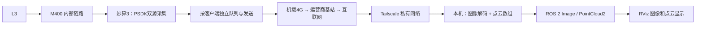

# L3 点云与可见光实时传输：MVP 开发方案

更新：2026-11-17（Asia/Shanghai）。最新要求：将二维点云相机画面作为普通高清流显示，不用RViz，只用妙算3/PSDK，增加画面切换按钮；切源修复以第11节为准，第10节保留SDK及传输边界，第9节定义普通预览入口。第1–10节保留此前阶段的方案和实测记录。

此前验收目标（下方第1–7节保留为历史XYZ方案；当前按第9节）：通过妙算3取得一路真实L3可见光H.264和一路真实XYZ预览点云，经M400机载4G传到本机，在现有ROS 2 Humble / RViz中同时显示并持续刷新。多电脑接收能力保留，不作为本轮验收前提。全程地面验证，沿用仓库禁止电机、起飞、飞控和云台运动的范围。

同日用户已批准 SDK 对照诊断、ROS/RViz 桥接和修复验证后的有界采集，要求**优先转发激光点云**。因此新增仅点云模式；视频不再是点云业务进程的必需模块。官方互联图中的负载↔妙算 MOP 和妙算↔自定义网络分别对应本项目取数与4G转发两段。

## 1. 先固定能力依据

采集、设备识别与机载网络能力以用户提供的 DJI PSDK 中文教程、API 及匹配版本官方头文件为依据。TCP 分发、电脑解码和 Tailscale 是本项目的工程选择，不属于 DJI 提供的现成双流服务。

| 能力 | DJI 官方依据 | 本项目采用方式 |
| --- | --- | --- |
| 精确识别设备 | [相机管理][camera]、`DjiCameraManager_GetCameraType()` | 查询实际挂载位置，必须确认为 `DJI_CAMERA_TYPE_L3` |
| 可见光视频 | [Liveview][liveview]、[固定版本头文件][liveview-header] | 复用已实测的 `DEFAULT` H.264 回调，电脑端解码 |
| L3 实时点云 | [相机管理][camera]、[固定点云示例][point-sample] | 按实际 L3 mount 连接 MOP `49154 / UNRELIABLE` |
| 机载4G上网 | [机载网络][internet]、[系统功能][system-features] | 飞机安装 DJI 增强图传模块、开通对应流量包并确认4G正常 |
| 自定义业务传输 | [PSDK 功能介绍][capabilities] | 妙算应用使用机载4G访问自定义网络服务 |

点云录制期间才提供 L3 实时点云；当前订阅教程要求退出 Pilot 2。该数据是实时预览点云，不能当成存储卡的全量测绘成果。[相机管理][camera]、[L3 FAQ][l3-faq]

当前 SDK 不作为依据承诺两路测绘相机视频、动态编码码率、SEI 曝光时间或硬件同步。第一版只交付已经有接口依据的一路可见光与一路预览点云。

## 2. 当前基线与采集前置阻塞

- 仓库基线：`5da04b4`；PSDK 3.18.0：`f3938d881e1628fc9a12e1b982b77060b9006311`。
- 妙算：Ubuntu 20.04.6 / AArch64 / GCC 9.4；M400 已读到 19.01.10.03。
- 妙算目前接 E2；L3 在 PSDK 负载位置 1。启动时仍须重新精确识别，不能将两种端口编号混用。
- 已验证短时可见光：8秒得到 518416 bytes H.264，解码为 1920×1080。尚无真实 XYZ 或持续双流验收。
- 2026-11-17 用户已安装4G模块。妙算经机载默认出口实际完成DNS解析与DJI/Tailscale HTTPS访问；尚未验收双流业务吞吐。USB管理链路出现过中断，不继续投入 Wi-Fi 配网。

**真实采集当前受 PSDK 内部内存错误阻塞。** [2026-11-16 测试报告](TEST_REPORT_2026-11-16.md)记录 ASan 捕获 `DjiMopChannel_UsbBulkSendData` 从28字节源读取4096字节。问题发生于运行期后台路径，不能通过跳过 DeInit 当作修复。

先用无录制最小模式和官方 socket 收发适配对照排除本项目适配原因；若官方路径仍复现，需取得适用于本组合的修复库/官方处理方案。修复候选先通过无录制视频持续运行和正常退出，再启用点云录制入口。协议、分发器和ROS显示以合成数据并行开发，分别记录软件与实际网络验证，不冒充真实L3采集。

## 3. MVP 网络架构

网络采用M400机载4G经运营商基站接入互联网，妙算3与本机通过Tailscale组网。此前已确认的多电脑分发能力保留；本轮仅验收本机接收与RViz显示，不再等待第二台电脑。



运营商基站提供蜂窝网络承载；本机分别建立视频与点云连接。本机不运行DJI SDK，也不经遥控器转发业务数据。

当前4G部署将业务端口绑定妙算`127.0.0.1`，由Tailscale用户态Serve转发；本机经SOCKS5连接。USB仅作可选管理和诊断路径，不能将飞机转发地址或用户态Tailnet地址当作妙算本机可绑定接口。

DJI 文档确认的是互联网和自定义网络通信能力，没有承诺公网固定地址、入站端口、Tailscale、TUN权限或业务带宽。现有Tailscale用户态路径已通过机载出口的合成流验证，真实L3码率仍待测；不扩展穿透或代理框架。

## 4. 核心代码只保留三个职责

保持现有 `onboard/`、`pc_viewer/` 目录，不迁移工程、不创建空模块。

| 职责 | 文件与开发内容 | 完成标准 |
| --- | --- | --- |
| 采集 | 复用 `onboard/l3_rgb_probe.c`、`l3_pointcloud_psdk.c`；初始化沿用 `metadata_inspect.c` 的独立流程 | SDK数据交给明确的字节回调，采集线程不直接操作网络 |
| 分发 | 已实现 `onboard/l3_stream.c/.h` | 两个独立TCP端口、每流最多两客户端、独立有界队列、发送与停止 |
| 接收与显示 | `pc_viewer/l3_stream.py`、`l3_points.py`、`l3_ros_bridge.py`及`l3.rviz` | 连续得到BGR及XYZ/强度/RGB数组，发布Image和PointCloud2，由本机RViz显示 |

上述核心源码与SDK无关集成测试已完成。`metadata_inspect.c --stream --streams points`只启动点云采集，`--streams both`为双流；原20秒探测模式保持不变。共享分发器保留两个监听端口，但仅点云模式没有视频采集或视频字节。SDK修复门槛仍默认关闭，尚未执行真实点云采集。

### 4.1 采集模块

- 视频保留一次 SDK Start/Stop 生命周期，网络客户端的加入或断线不触发反复初始化相机。
- H.264 回调的数据仅在调用期间有效；及时复制入有界缓冲。一个回调不是一帧，也不是一个 NAL。
- 点云复用精确 L3 验证、MOP 地址映射和包布局检查；给持续接收增加明确的停止信号与独立读取线程。
- 点云同时提供短时探测和持续读取接口。SDK Connect/Recv/Stop 没有可依赖的公开硬取消参数，不能把“循环30包”或设置很大包数当成持续服务或时间保证。
- 录制命令沿用现有明确入口与停止机制；连接电脑、重连网络不自动开启或停止用户已有录制。
- 持续入口支持显式60秒/5分钟测试时长并保留独立Stop；首次真实20秒取点验收后才能进入后续长测，不通过增大收包次数替代时长控制。

传输层只需要两个发布入口，接收借用缓冲并负责复制，不引入统一传感器对象模型：

```text
publish_h264(context, bytes, length)
publish_points(context, packet, length)
```

### 4.2 分发模块

首版固定两条TCP数据通道，复用已经存在的点包封装：

| 项目端口 | 数据 | 格式 |
| --- | --- | --- |
| 9101/TCP | 真实点云 | `L3P1` + 大端 uint32 长度 + 一份完整原始 DJI 点包 |
| 9102/TCP | 可见光 | 按源顺序发送 H.264 字节，不添加自定义头、不转 JPEG |

49154是DJI内部MOP通道，与上述TCP端口不同。旧点云诊断工具默认9010；用于MVP时显式指定9101。`L3P1`仍是项目自己的封装，不是DJI协议名。首版保留原包，暂不重新定义点云二进制格式。

每流最多两个客户端，共四条业务连接。连接的生命周期由电脑订阅决定；所有客户端共享同一份相机/点云采集，不重复订阅 SDK。

最小队列约定：

- 每客户端视频排队上限先设2 MiB、点云1 MiB，另限制记录数；实际速率确定后调整常量，不引入动态配置中心。
- 发送线程从队列取数据，SDK回调只复制入队；网络慢时不阻塞采集及另一台电脑。
- 点云仅丢弃完整、尚未发送的旧包；已部分发送的包失败后关闭该连接，避免后续解包错位。
- 视频不任意丢弃回调字节；队列满或发送超过预算时断开该慢客户端。
- 视频新连接先发送缓存的 SPS/PPS，再从完整 IDR 访问单元的起始边界接入，避免接入多slice图像的中间。用小型增量 Annex-B 解析处理跨回调起始码，不实现编码器或完整 H.264 解码器。
- 视频实际封装、SPS/PPS和IDR行为须用真实 SDK 流确认；“等到可解码起点”属于验收条件，不能只用TCP建连成功代替。

仅统计收到/发出的字节和点包、解码帧数、队列丢弃、慢客户端断开及重连次数。队列限制和正确分帧属于实时传输本身，不另起通用可靠性框架。

### 4.3 电脑接收模块

- 视频：使用现成 H.264 解码库增量解码，得到 `uint8 H×W×3` BGR 数组；OpenCV显示和算法读取共用该输出。
- 点云：复用现有 `parse_packet()`，输出XYZ、强度和RGB；保留源序号、时间原值及本机接收时间。
- 电脑端处理TCP拆包和断线；协议尺寸与包长上限沿用现有校验。
- `l3_ros_bridge.py`直接构造ROS消息，复用本机Humble和现有`.venv`，无需`cv_bridge`。只发布新收到的对象，不以相同旧包伪装刷新；源序号重置后仍接收新包。
- `/l3/camera/image_raw`发布`sensor_msgs/msg/Image`（bgr8），`/l3/points`发布`PointCloud2`（XYZ/强度float32，RGB uint32，20字节/点）。原机载16字节点结构和L3P1不变。RViz显示项和发布端均使用Best Effort、深度1。
- 点云必须显式选择`--raw-coordinates`诊断模式（frame=`l3_raw`，不承诺米/轴/原点），或在源单位核实后传`--xyz-scale-to-meters`（frame=`l3_local`，保持源轴）。本轮不要求SLAM、地图定位、投影或硬件同步。ROS时间为本机系统接收/解码时间，源时间原值保留。

DJI固定头定义20字节点云头、8字节CRC和16字节点记录。当前尚须核对真实包边界、坐标单位/原点、时间单位和CRC算法；不将未知时间重命名为曝光时间，也不把未经核对的XYZ直接标成米或世界坐标。[点云结构][point-header]

## 5. 4G接入只做必要步骤

1. 用户安装与 M400 配套的 DJI 增强图传模块，开通对应流量包，确认飞机4G正常。
2. 在妙算上验证DNS、HTTPS和实际业务连接。增强图传开关状态、遥控器有网或出现4G图标，都不能单独证明妙算业务通道可用。
3. 沿用飞机内部网络；官方说明负载网络访问在满足4G前提时默认启用。不安装AT拨号程序，不改`onboard`的IP/DHCP。
4. 当前账号无CAP_NET_ADMIN，两端已准备官方Tailscale用户态模式。妙算通过Serve转发到回环9101/9102；本机接收器显式使用`--socks5 127.0.0.1:1055`。两端登录同一Tailnet后再验收实际数据通道。
5. 测量本机接收真实双流的实际码率、刷新与队列情况，完成RViz显示；不以第二台电脑或新增传输协议作为前置条件。

网络工程选择与DJI能力分开记账：DJI文档提供网络出口能力依据，实际出口仍由本项目验证；本项目实现业务连接、双流分发及电脑解码。Tailscale访问范围限制在参与联调的设备与业务端口，不新建一套应用账号/控制协议。

### 上行与流量计算

本轮验收仅一个接收端。保留的多客户端能力会重复占用机载上行；设视频实际码率为 `Rv`，点云码率为 `Rp`：

```text
总业务上行 ≈ 客户端数量 × (Rv + Rp) + TCP/组网开销
点云封装字节/秒 ≈ 16 × 点数/秒 + 36 × 点包数/秒
流量 GB/小时 ≈ 平均总上行 Mbps × 0.45
```

36字节由28字节DJI包前缀和8字节L3P1封装组成，不含TCP/网络开销。这是计算方法，不是L3实测速率。已有8秒视频样本也不能作为持续带宽指标。

## 6. 按这个顺序实现与验收

| 顺序 | 工作 | 通过条件 |
| --- | --- | --- |
| 0 | SDK修复与数据源核验 | 可见光持续取流并正常退出；随后有界点云采集收到真实有效XYZ，停止结果可确认 |
| 1 | 核心传输离线实现，可与0并行 | 合成点包与有效合成H.264可经TCP连续接收；拆包、解码和停止通过 |
| 2 | 真实点云优先 | 有界20秒录制/收点/停录，校验原始XYZ，再经4G送至本机；不以视频并发或USB恢复为前提 |
| 3 | 本机ROS桥接 | 接收器输出转换为Image/PointCloud2，RViz显示项、编码和局部frame正确；合成数据仅用于软件验证 |
| 4 | 安装4G后的网络验证 | 妙算机载出口、Tailnet及两条业务TCP均可用，记录实际连接类型和上行 |
| 5 | 4G本机RViz验收 | 本机经4G实际收到来自L3的可见光及XYZ，RViz同时持续刷新图像与点云，保留来源及速率统计 |

60秒用于首轮持续观察，最终计划5分钟双流显示；这些是本项目验收窗口，不是DJI保证的稳定性指标。合成数据、旧录像和点云预览视频不能替代真实XYZ。全程保持地面测试。

分发器、增量解码和ROS桥接已实现；当前先处理源端SDK阻塞并验证真实点云。每项代码以真实数据或明确标注的合成流证明能工作。

ROS桥接与RViz已纳入当前必需工作；SRT/RTMP、全量遥测、同步标定、自动转码、自启动、录像管理和Web控制台仍不前置。

## 7. 已实现代码、运行与实测边界

已交付分发器、持续点云读取及停止控制、SDK双流入口、Python连续接收与解码。SDK双流入口`--stream`会启动点云录制，仍受`L3_ENABLE_POINT_RECORDING_PROBE=OFF`默认门槛限制；拒绝发生于读取私有配置、网络监听与SDK初始化之前。

新增仅点云接收/RViz启动命令（本机程序不启动机载录制）：

```bash
bash scripts/start_l3_rviz.sh --host MANIFOLD_TAILNET_IP \
  --socks5 127.0.0.1:1055 --raw-coordinates --seconds 60
```

默认`--streams points`，双流加`--streams both`；无界面检查加`--no-rviz`。原始坐标模式仅用于诊断，真实空间尺度须在单位核验后确定。合成ROS测试：

```bash
source /opt/ros/humble/setup.bash
.venv/bin/python pc_viewer/test_l3_ros_bridge.py
```

本机SDK无关编译与验证：

```bash
cmake -S onboard -B build/transport -DL3_BUILD_PSDK_APP=OFF -DCMAKE_BUILD_TYPE=Release
cmake --build build/transport -j2
cd build/transport && ctest --output-on-failure
```

在仓库根目录准备Python环境后：

```bash
python3 -m venv .venv
.venv/bin/python -m pip install -r requirements.txt
.venv/bin/python pc_viewer/test_l3_stream.py
.venv/bin/python pc_viewer/test_stream_integration.py
```

电脑接收命令（USB路径；实际采集程序尚未启用）：

```bash
.venv/bin/python pc_viewer/l3_stream.py --host 192.168.42.130 --seconds 60
```

Tailnet接收命令（先替换实际妙算Tailnet地址，并完成两端授权与Serve配置）：

```bash
.venv/bin/python pc_viewer/l3_stream.py --host MANIFOLD_TAILNET_IP --socks5 127.0.0.1:1055 --seconds 60
```

妙算程序仅Tailnet使用时绑定`127.0.0.1`；同时做USB测试时显式绑定`0.0.0.0`。`192.168.42.130`是飞机转发地址，不是妙算本机接口地址，不能直接绑定它。

本机和妙算已安装并启动经官方SHA256核对的Tailscale 1.104.7用户态进程，已授权到同一Tailnet；没有修改系统路由或配置开机自启。二进制位于`~/.local/opt/tailscale-1.104.7/`，私有状态与socket位于`~/.local/state/l3-tailscale/`。妙算Serve9101/9102已转发到本机回环对应端口，本机SOCKS5为1055；账号、授权链接和节点身份不写入仓库。用户态模式与TCP转发依据[官方userspace说明](https://tailscale.com/docs/concepts/userspace-networking)及[官方Serve说明](https://tailscale.com/docs/reference/tailscale-cli/serve)，不是DJI SDK能力。

已验证：接收器8项测试、C到两个Python接收器的有效合成H.264/BGR与点云字段集成、单客户端断开隔离/重连、旧图像/点云协议。C核心在本机及妙算原生严格GCC、ASan/UBSan/泄漏检测通过。最新源码在妙算原生编译链接，14项CTest（分发、reader、控制器11场景、诊断/点云模式隔离）通过；新增6项ROS消息及真实本机发布订阅测试通过。默认`--stream --streams points`已实测在配置读取和SDK初始化前返回2。

实际机载出口上的Tailnet验证已通过：两端口各两连接的合成TCP回传逐字节一致；随后在妙算运行不链接SDK的C回放器，以有效合成H.264和合成点包经Serve/4G送往本机两个接收实例，实际解码、XYZ/强度/RGB字段、单端断开隔离与重连解码均通过。两实例在同一台电脑，不替代两台物理电脑验收。该测试是小流量链路验证，不是实际L3码率的带宽测试。

本轮路径探测为DERP_RELAY，往返延迟721/313/354ms；未验证DIRECT或低延迟指标。USB管理中断后已通过Tailnet SSH完成最终原生编译和测试。VNC服务卡住的问题另行修复，不进入业务代码。

点云优先阶段新文件在`/open_app/workspaces/dji/l3-dev/points-20261117`。本次已运行两轮无相机、无录制的纯Core诊断：本项目socket与官方阻塞socket下分别在14.300/14.649秒复现相同28字节分配上READ4096，见[实测报告](TEST_REPORT_2026-11-16.md#2026-11-17无相机无录制的最小对照)。当前无已验证SDK修复，没有启动真实点云录制。

最新4G→ROS/RViz验证：妙算SDK无关回放器发送合成点包，本机默认仅点云桥接运行32.016秒，接收和发布319包，点包/ROS发布错误0，视频连接0；独立ROS订阅者检查50条消息的XYZ/RGB与时间，RViz实际显示合成点。真实XYZ及最终真实双流验收仍未完成，合成结果不能替代。

[camera]: https://developer.dji.com/doc/payload-sdk-tutorial/cn/function-overview/advanced-function/basic-camera-management.html
[liveview]: https://developer.dji.com/doc/payload-sdk-tutorial/cn/function-overview/advanced-function/liveview.html
[liveview-header]: https://github.com/dji-sdk/Payload-SDK/blob/f3938d881e1628fc9a12e1b982b77060b9006311/psdk_lib/include/dji_liveview.h
[point-sample]: https://github.com/dji-sdk/Payload-SDK/blob/f3938d881e1628fc9a12e1b982b77060b9006311/samples/sample_c/module_sample/camera_manager/test_camera_manager.c
[point-header]: https://github.com/dji-sdk/Payload-SDK/blob/f3938d881e1628fc9a12e1b982b77060b9006311/psdk_lib/include/dji_camera_manager.h
[internet]: https://developer.dji.com/doc/payload-sdk-tutorial/cn/advanced-function/access-internet.html
[system-features]: https://developer.dji.com/doc/payload-sdk-tutorial/cn/manifold-quick-start/manifold-platform-capabilities/system-features.html
[capabilities]: https://developer.dji.com/doc/payload-sdk-tutorial/cn/manifold-quick-start/psdk-capabilities-overview.html
[l3-faq]: https://enterprise.dji.com/zenmuse-l3/faq

## 8. 二维点云预览经妙算和4G回传（2026-11-17）

本节是此前800kbps/RViz实验记录，命令已由第9节原码流入口替代。

用户本阶段将优先目标调整为回传 Pilot 2 中的二维点云相机画面，先不处理存储，明确只用妙算3、不用MSDK。它通过 `sensor_msgs/msg/Image` 显示，不是包含XYZ的 `PointCloud2`，不替代此前真实点云验收。

### 已验证的源端与传输事实

- 当前 M400 / L3 / PSDK 3.18.0 的相机类型精确为 L3，CameraManager `GetStreamSourceRange` 返回 `[7,14]`，`GetCurrentCameraStatus` 返回源14。
- `DjiLiveview_StartStream(..., DJI_LIVEVIEW_CAMERA_SOURCE_DEFAULT, ...)` 取得了1920×1080真实二维彩色点云画面。本机实际解码并目视确认；`DEFAULT`不能固定标为“可见光”。CameraManager源ID与Liveview源枚举是不同参数域，不将14直接强转传入Liveview。
- 原始25秒订阅产生47,005,975字节，约15.0Mbps；本机只解码32帧，转发器因慢客户端断开1次。当时采用压缩预览；不能据此断言原码流永远无法通过4G。第9节重新验证原码流与发送窗口。
- 妙算FFmpeg以960×540、10fps、800kbps目标参数重编码后，60秒订阅产生5,342,336字节压缩码流。本机收到4,904,625字节、解码546帧、解码错误0，实际观察268次最新帧更新，覆盖52.98秒，最大观察更新间隔约1.02秒。10fps是编码配置，不是承诺每秒10次屏幕刷新。
- 该轮转发器接受1个真实视频客户端，慢客户端断开0；结束阶段send error=1。本机统计还包含发布服务启动前/停止后Tailscale Serve连接重试，不能把这些全部解释为中途断流，也不能宣称全程零网络错误。
- `SetStreamSource(7)`有界试验及恢复请求均返回`0x00000021000000e0`。后续源14检查及点云画面再次通过，未观察到源被改变。最终代码不保留切源写操作，仅核对当前源；不能承诺PSDK自动切换或两路同时输出。

### 当前链路

```text
L3 当前二维点云画面
  → 妙算 PSDK Liveview DEFAULT
  → 本地 TCP 19102（原始H.264，不出机载网络）
  → FFmpeg 内存解码/缩放/重编码
  → FIFO → l3_video_relay → 127.0.0.1:9102
  → 已配置的 Tailscale Serve / 机载4G
  → 本机 H.264 解码 → OpenCV 或 ROS Image / RViz
```

原始媒体不写文件。运行日志在两端私有目录；本轮少量画面验证快照仅留本地`.validation/`，不提交。没有启动视频或点云录制、扫描、电机、飞控或云台动作。PSDK已知内存错误没有被修复，当前短时视频实测不能当作长期SDK稳定性或真实XYZ验收，`L3_ENABLE_POINT_RECORDING_PROBE`仍OFF。

### 构建与启动

妙算保留现有PSDK及本地凭据，在独立目录构建本仓库`onboard`，不要启动综合示例：

```bash
cmake -S onboard -B build \
  -DPSDK_ROOT=/path/to/Payload-SDK-3.18.0 \
  -DL3_ENABLE_POINT_RECORDING_PROBE=OFF -DCMAKE_BUILD_TYPE=Release
cmake --build build -j4
(cd build && ctest --output-on-failure)
```

本轮部署目录为妙算`/open_app/workspaces/dji/l3-dev/preview-20261117`。需要系统`ffmpeg`含`libx264`，本机已有，无需新增安装或修改系统配置。机载脚本默认只绑定loopback，继续使用已配置的Tailscale Serve9102；不新增公网监听、路由或服务自启动。

本机启动（替换本地私有地址；SSH别名和凭据保持本地配置）：

```bash
bash scripts/start_l3_preview_4g.sh \
  --host MANIFOLD_TAILNET_IP --expected-source 14 --seconds 60

# 同一路画面在现有ROS 2 Humble / RViz中显示：
bash scripts/start_l3_preview_4g.sh \
  --host MANIFOLD_TAILNET_IP --expected-source 14 --seconds 60 --rviz
```

`--expected-source 14`校验的是本轮设备已确认的源，检查失败会拒绝启动预览，**不会写入14或开启录制**。更换设备、固件或当前源后先用`--video-info`读取，不能按编号盲试。省略该参数允许回传当前源，但不预先认定图像内容。`--no-display`用于只收流验证。SSH只管理进程，业务图像走所指定的Tailnet/SOCKS连接。

妙算单独启动可调分辨率/码率，所有进程有有限运行时间和外部超时：

```bash
bash scripts/run_l3_preview_onboard.sh \
  --bin-dir /absolute/path/build --config /private/psdk.conf \
  --expected-source 14 --seconds 60 --width 960 --fps 10 --bitrate-kbps 800
```

正常结束会停Liveview、编码器和转发器。强制终止或本机窗口提前关闭时，远端可能继续到本次有界超时结束；不承诺关闭本机窗口就是机载立即停流。不能同时启动另一份占用相同SDK/端口的采集程序。

### 验证覆盖

原JPEG协议离线测试通过；H.264/点包接收与双客户端集成测试9项通过；新增stdin视频转发的真实合成H.264解码、断开重连、空闲取消测试通过；ROS桥接6项通过。妙算原生14项CTest通过，包含视频模式不调用点云录制控制器、视频源范围长度越界拒绝、精确L3检查及清理。`test_diagnostic_modes`修复了旧布尔参数仍被当作枚举使用的测试问题，明确分别验证`POINTS`、`VIDEO`、`BOTH`。

最终`--expected-source 14 --rviz --seconds 45`实测：当前源14核对通过；本机收到3,773,089字节、解码424帧、发布236条Image，解码错误/ROS发布错误/连接错误均0，ROS未发布任何PointCloud2。转发器输出3,968,951字节，1个连接，慢客户端断开0、send error=0。RViz界面已目视确认显示二维彩色点云；其三维主视图为空属于当前Image模式，不表示XYZ接通。发布器、FFmpeg、转发器、本机接收返回码均0。原始截图和日志仅本地保存，不随代码上传。

## 9. 原始高清普通视频窗口与切换按钮（2026-11-17）

用户最新要求覆盖前述阶段：将二维点云相机画面视为普通视频，与可见光共用本机窗口，增加切换按钮，不接入RViz，不使用MSDK，高清回传且不压低码率。本轮不要求XYZ或双路同时显示。

### 实现与运行

```text
L3 当前视频 → 妙算 PSDK Liveview DEFAULT → 原始 H.264 TCP 9102
            → 已有 Tailscale Serve / 机载4G → 本机 PyAV 解码 → 普通视频窗口
本机切换按钮 → SSH 标准输入 → 精确L3/可用源检查 → PSDK设置 → 读取实际源
```

`run_l3_preview_onboard.sh`已移除FFmpeg、FIFO、缩放、帧率和码率参数，直接运行有界原码流发布器；本机`l3_preview.py`显示视频、当前源、切换按钮、接收Mbps与解码fps，不启动ROS/RViz。H.264原始NAL载荷保持不变；TCP分包与Annex-B起始码规范化不属于重编码。不是无压缩像素流：相机本来就输出H.264，但本项目不再降低源画质/码率，也不调用SDK编码策略接口。窗口按尺寸适配只影响本机显示。

发布器默认只绑定127.0.0.1，沿用已有Tailnet Serve9102转发，不新增公网服务。机载目录：`/open_app/workspaces/dji/l3-dev/hd-preview-20261117`。按第8节CMake方法构建，保持`L3_ENABLE_POINT_RECORDING_PROBE=OFF`，复制`onboard/`与`scripts/`，不要运行综合SDK示例。本机依赖现有`.venv`的PyAV、NumPy、OpenCV和系统`python3-tk`。

```bash
bash scripts/start_l3_preview_4g.sh \
  --host MANIFOLD_TAILNET_IP --seconds 300
```

支持`--ssh-host SSH_ALIAS`、`--identity KEY_PATH`、`--remote-root DIR`、`--remote-config PRIVATE_PATH`、`--mount 1..3`、`--socks5 HOST:PORT`、`--no-display`。默认沿用本机SOCKS1055，直连传`--socks5 ''`；地址与凭据保留私有配置。`--expected-source 14`可选，只核对源，不负责切换。旧`--rviz`、`--width`、`--fps`、`--bitrate-kbps`不再接受；没有自动退回压缩模式。

预览1..300秒，默认300秒。关窗或停止按钮发送`stop`并关闭控制输入，机载停止Liveview并清理SDK；另有`seconds+35`秒外部超时和3秒强制结束保护。SDK调用可能阻塞，进程超时退出不表示SDK已成功清理。启动器用`flock`防止重复运行同一高清启动入口，不代替其他SDK应用的互斥检查。原始媒体不落盘，有限诊断日志在私有`.validation/hd-preview-*`与机载0700临时目录；验证截图仅本地保留。

### 切换的实际边界

`DjiCameraManager_GetStreamSourceRange()`在此设备返回`[7,14]`。7是SDK头文件中的`VISIBLE_CAM`；14是本机实测二维点云画面源。不能将这两个CameraManager源ID当成Liveview枚举；订阅仍用`DEFAULT=0`。每次按钮请求都重新检查挂载位置精确为L3、范围数组长度及目标源，调用`SetStreamSource`后读回实际状态。ACK成功但实际源未改变，也必须报告未确认。

**当前M400/L3/PSDK组合仍拒绝软件切换。** 视频已经运行时，按钮请求源7实测返回`0x00000021000000e0`，实际源仍14；该错误是官方`DJI_ERROR_CAMERA_MANAGER_MODULE_CODE_UNSUPPORTED_COMMAND`。窗口显示失败并保留实际源，不能将按钮接线、范围包含7或成功读到14当作切换成功。此前另一个有界Liveview子源1实验虽返回启动成功，8秒收到0字节，不作为可见光通路保留，也没有继续盲试其他源。

源码保留按钮及受检查的设置路径，方便后续在支持该命令的SDK/固件上验证；本轮未证明PSDK可以切换到可见光，更未证明两路同时输出。若实际源变更或读回不确定，重新建立解码连接，避免显示缓存的旧源帧。该恢复路径有合成测试，不冒充实机切换测试。

### 传输与控制约束

L3本轮仅在订阅启动时观察到IDR；后续`RequestIntraframeFrameData`返回成功却没有新IDR，故启动顺序改为TCP服务就绪→本机接收器连入→开始Liveview，等待客户端最多10秒。首个源状态读回属于启动元数据，不会误触发解码器重连。慢客户端仍有上限：每客户端视频队列8MiB/128记录、单记录发送预算3秒，超限断开；视频socket发送窗口由旧16KiB提高。不能以无限堆积保持假实时，也不能因4G不够快而暗中降低画质。

断线后原始流是否能重新提供解码起点依赖设备；当前关键帧请求的ACK不能保证IDR。若窗口停更，应停止本次预览后重启会话，不能将TCP重连当作已恢复图像。窗口会显示超过2秒未收到新帧。Mbps/fps是本机接收/解码统计，不是端到端延迟或相机硬件时间同步指标。

SSH控制协议仅供本入口：每条ASCII命令一行，允许`status`、`visible`、`point`、`stop`；其他命令、NUL及过长输入拒绝，不解释为shell，不允许任意SDK调用。输入EOF结束本次会话。响应为`event=video_control action=... requested=... previous=... current=... success=yes|no write_attempted=yes|no code=...`；`current=-1`表示未知。H.264 TCP及旧Android/JPEG协议均未改变，不修改Android sender。

全程地面：无电机、飞控、云台、扫描或录制。相机源按钮是明确的预览源写操作，不能称为纯只读；已知SDK内存错误仍未修复，XYZ录制门槛继续OFF。

### 本轮实机结果与验收缺口

普通窗口已目视显示真实1920×1080彩色点云画面，截图仅留本地。45秒订阅共83,560,796字节，约14.86Mbps；本机收8,311,570字节、解码118帧，期间接收速率约4–6Mbps，随后停更。机载慢客户端断开1次，发送错误0，本机解码错误1次。因此原画质显示路径成立，**持续高清实时回传未通过**；当前4G/DERP路径的实测接收吞吐低于源输出，不把“网络已连接”或收到少量帧当作稳定验收。

该轮Liveview Stop/Deinit、CameraManager Deinit、Core Deinit的ACK均成功，但随后输出`corrupted double-linked list`和`timeout: the monitored command dumped core`；本机SSH最终返回255。不能以清理ACK成功声称进程正常退出，也不能仅根据此未插桩的崩溃定位具体越界写来源。既有SDK ASan越读仍未解决；本轮不再追加采集验证，不启录制。

离线验证涵盖精确L3与指定mount、源范围边界、失败ACK/延迟读回/源不确定、初次状态不误重连、SSH参数引用、合成H.264负载一致性、源重置后重新等待SPS/PPS/IDR和慢客户端隔离。最终15项妙算原生CTest、15项Python控制/接收/合成流集成测试通过；原JPEG协议测试通过；本机SDK无关传输、源控制桩、模式隔离桩均通过ASan/UBSan/泄漏检查。结束后确认机载无残留采集/转码进程。软件测试通过不替代上述实机限制。

## 10. SDK越读、退出与视频恢复修复（2026-11-17）

本节替代前文“尚无可验证修复”和“手动关闭后重开”的旧状态。当前仍为地面二维视频预览，不启用真实XYZ录制或飞控。用户重新插拔后恢复妙算管理连接，USB随后仍有间歇失联；通过已有机载4G/Tailscale完成部署。当前默认目录为`/open_app/workspaces/dji/l3-dev/repair-20261117`，旧`hd-preview-20261117`保留。

### 修复内容

`patch_psdk_usb_padding.py`仅在构建目录生成新的静态库，输入官方库和目标ELF对象都必须匹配完整SHA256：

| 对象 | SHA256 |
| --- | --- |
| 官方3.18.0 ARM64 archive | `5725cc72824d915410be59e98cb31b4d269510c4615c1033da8d5fffbffdb5e7` |
| 官方`dji_mop_channel.c.o` | `65a5663a37d24014e0b34fb1ae45fc74b543bc72540b964fcb7f8f3051d46ede` |
| 修正构建副本 | `997f2a44a660c7361b4f9ba6f74bc34788792002c6c44554253ae1c9ef2a3387` |

定位到USB发送函数将短包长度向上取4096后，又把这个长度用于读取源缓冲。修正只涉及该函数一条长度指令和一处`memcpy`重定位：保留实际uint16长度，调用`L3Usb_CopyPadded`复制有效载荷，再在SDK目标缓冲补零。USB发送块长度不变，源分配仍是原长度，其他`memcpy`保持原样。补丁校验函数布局、指令、符号、重定位；不接受未知库，不覆盖vendor，也不分发DJI二进制。这是项目修正，不是DJI官方修复版本。

`l3_osal.c`处理后续实机检测暴露的问题：通过对齐局部变量和`memcpy`写入SDK的紧凑句柄字段；新线程自己设置延迟取消，销毁时执行cancel/join后才释放句柄；CameraManager对未创建的下载器信号量执行销毁时将NULL作为无资源操作。USB初始化也通过对齐局部句柄调用官方HAL。没有扩大源分配、关闭检测器或跳过DeInit。

构建保持点云门槛关闭：

```bash
cmake -S onboard -B build \
  -DPSDK_ROOT=/path/to/official/Payload-SDK-3.18.0 \
  -DL3_FIX_MOP_USB_PADDING=ON \
  -DL3_ENABLE_POINT_RECORDING_PROBE=OFF \
  -DCMAKE_BUILD_TYPE=RelWithDebInfo
cmake --build build -j4
(cd build && ctest --output-on-failure)
```

`L3_FIX_MOP_USB_PADDING`默认ON；OFF仅用于明确的旧库故障对照，不表示安全降级。修正版仍受SDK内部未释放资源影响，**不构成全SDK稳定性或真实点云录制门槛已通过的结论**。

接收器遇到损坏帧或单个无效H.264访问单元时计数并继续解码，保留TCP与解码器。连接断开后，窗口请求停止旧Liveview，等待SDK进程正常退出，再建立新的接收连接并重新订阅启动IDR。重启使用原预览时间的剩余预算；SDK异常退出不会自动重复。已确认的实际源变化同样需要新的订阅，避免丢失切换时的首个IDR；暂时读源失败不清空正常解码器。`hd_complete`输出重订阅次数及末帧年龄；末帧超过3秒未更新时返回失败。H.264传输协议和旧Android/JPEG协议不变。

### 实机与离线证据

- 最终20秒视频诊断：947次回调、37,683,136字节，Liveview Stop/Deinit、CameraManager Deinit、Core DeInit全部成功，USB补零修正计数20；启用ASan及`UBSAN_OPTIONS=halt_on_error=1`，无越界/未定义访问报告。
- 同一轮LeakSanitizer在退出报告12,000,762字节、74次分配残留，诊断返回非零。不能称完整ASan/泄漏检查通过。预览使用有时限的独立SDK进程，退出后由操作系统回收，仍需要后续SDK资源治理。
- 正常版15秒回环收到28,749,673字节并退出0；样本含1个IDR和439个P片、无filler NAL，压缩比例约0.999，不能靠清除填充解决带宽差额。短样本仅存妙算私有目录。
- 修正版45秒4G测试：本机1920×1080、153帧/10,599,549字节，机载退出0；仍因客户端跟不上产生断线和停更。
- 自动恢复90秒测试：累计543帧，2次完整重订阅均恢复图像，3个机载会话均正常退出。末帧停更17.24秒，因此整轮实时验收失败，不将“有恢复”写成持续流畅或低延迟通过。
- 18项妙算原生CTest、17项Python控制/流集成测试、旧JPEG协议测试通过。新增覆盖真实pthread取消/清理等待、未对齐句柄、精确源长度与补零、合成ELF补丁完整性、坏访问单元同连接恢复、重订阅等待SDK退出和时间预算。SDK无关新增C测试通过ASan/UBSan。

### 源切换与网络边界

修正此前表述：CameraManager范围`[7,14]`来自SDK按机型提供的表，并非设备写能力确认。SDK日志及函数检查证实`SetStreamSource`的`0x00000021000000e0`发生在本地功能检查。仅在私有隔离构建中移开这一检查后，发送源7仍返回`0x00000021000000e3`，读回保持14，随后确认仍为点云源。**该分支未成功，不进入默认构建**。7/14作为Liveview子源的独立8秒测试均返回`0x100`且零字节，当前实现继续使用DEFAULT，不混用枚举。不能据此扩大为“L3根本不能切源”，但本项目按钮尚未完成实机切换。

用户明确保留现有通路，不继续优化或引入新服务器。备用加密中转只做合成带宽测试，已停止；实际L3媒体仍走原Tailscale。关闭桌面系统代理，视频DERP连接绕过环境代理后，8秒合成测试为4.806Mbps，真实原视频仍约15Mbps。此为本次路径测量，不是运营商、4G模块或其他网络的上限结论。两者差额仍会耗尽有界队列，不能以增加缓存、丢掉有参考依赖的P帧或暗中转码宣称原画质实时通过。下一轮需在用户确认的可用网络状态下继续验收；现有代码、普通窗口和源切换失败提示保持可运行。


## 11. 切源按钮修复（2026-11-17）

本轮用户明确“把切源按钮修了，其他先不动”。本节替代第9、10节关于按钮未切通的结论。只修改源控制、启动源核对和按钮状态，不改变网络、H.264传输、码率、分辨率、录制、ROS或SDK USB修正。

### 根因与实现

PSDK3.18的L3静态范围表为`[7,14]`，但L3实际可见光是`WIDE_CAM=1`，二维点云是14。向7发送切源命令会收到设备参数错误；SDK公共`SetStreamSource`还会先被本地功能表拒绝。此前将静态表中的7作为可见光目标，是按钮失败的直接原因之一。

`l3_video_control.c`现在在检查有效挂载端口和精确`DJI_CAMERA_TYPE_L3`后，只允许相机源1/14，通过库内`DjiCameraManagerUtil_ActionSync`发送原SDK的相机源命令02/09。载荷11字节，仅首字节为目标源，最后字节固定2，其余0；相机寻址、ACK及超时由SDK处理。该兼容层使用内部ABI，所以CMake无论USB补丁是否开启，都校验官方3.18 ARM64 archive SHA256 `5725cc72824d915410be59e98cb31b4d269510c4615c1033da8d5fffbffdb5e7`，未知库拒绝构建。此为本项目兼容实现，不是DJI新增公共API；SDK升级时须重新核验。

没有将此前私有诊断的功能检查跳转补丁加入正式库。官方[OSDK视频切源实现](https://github.com/dji-sdk/Onboard-SDK/blob/master/osdk-core/advanced-sensing/api/src/dji_liveview_impl.cpp)曾用于核对02/09命令，1字节旧格式加源7的隔离实验仍失败；最终实现保留PSDK的11字节格式，修正源编号。正式执行只使用妙算3/PSDK，不调用MSDK或遥控器App。

每次写入后读回当前源，ACK或读回不符时不报成功。普通窗口以实际1/14更新标签和按钮，切换时清除旧图，沿用完整停止旧SDK会话再订阅DEFAULT的过程，取得新源启动IDR。切换提示不再误写“网络中断”，切换期间和会话结束前10秒禁用按钮。Liveview订阅源继续为DEFAULT=0，不能把相机源1/14当成其子流枚举。

### 验证与部署

隔离版已完成14→1→14：两个写请求ACK为0，读回分别为1和14；本机分别解码1920×1080可见光和二维彩色点云画面，结束返回0。首次正式Tk测试发现视频EOF早于控制ACK时会沿用旧源启动，已修正等待/最终读回优先级，并加入对应竞争条件回归测试。最终实际Tk按钮完成14→1→14→1→14，两轮往返四次命令均成功，每段分别取得32/30/30/32/30帧才继续下一次切换；累计解码201帧、末帧年龄0.06秒、结束码0，最后保留源14。所有画面均为1920×1080，本机已目视核对真实可见光与二维点云。18项妙算原生CTest、19项Python测试通过；新增切源C测试在ASan/UBSan下通过，验证精确设备/端口、1/14往返、完整载荷、拒绝旧源7、延迟读回、ACK失败与实际状态变化。启动核对不再受错误的静态范围表影响。

默认部署保持`/open_app/workspaces/dji/l3-dev/repair-20261117`；验证候选保留于`source-fix-20261117`。真实帧、SDK对象和原始日志只在私有目录。没有起飞、飞控、云台运动、扫描或录制操作；本轮通过的是按钮切源和新画面恢复，长期原码率实时传输及SDK残留泄漏仍沿用第10节的验收边界。

## 12. 同进程切源试验（2026-11-18）

`--fast-switch` 仅用于受控 video 预览。地面窗口仍通过 SSH 发送 `visible` 或 `point`，收到含 `resubscribe=yes` 的读回事件后关闭并等待旧接收器结束，再发送 `resume`。妙算3先完成 `StopStream` 和本应用回调排空，核对实际源，再在收到 `resume` 时清除旧视频队列和 H.264 参数集、作废旧视频客户端，发出 `video_relisten`。新 TCP 客户端接入后，在同一进程调用 `StartStream(DEFAULT)`。预览等待新的可解码帧，以其上屏时间作为本地计时终点。命令始终保留在 SSH 控制通道，TCP 9102 仍传原始 H.264 字节。

新的回调入口与上一轮区分，SDK 成功停流才允许重启。若源状态未知、重新订阅失败或首帧超时，预览请求完整退出。仅在旧进程正常退出且原预览时间有余量时，以最后确认的源重新启动，剩余时间使用完整重连。会话互斥锁、外部超时和点云录制构建门槛继续生效。

本机 `hd_switch_frame` 以单调时钟记录点击到首帧时间，并标识 `fast` 或 `full`。机载 `fast_switch` 事件记录切源读回、旧订阅停止、新客户端连入及重新订阅的累计耗时。分别统计两种切换方向的首帧中位数、P95 及回退次数。原验收仅保留到新源 30 帧约 12.5–15.9 秒的估算，不能当作精确首帧基线。

候选版已在妙算3原生构建，19 项 CTest 和 30 项 Python 测试通过。同一进程在妙算回环执行 40 次真实 L3 切换，两方向各 20 次。发送切换命令到新连接收到 SPS、PPS 和 IDR 的中位数为 3.174 秒，P95 为 3.275 秒，范围为 3.129–3.573 秒，退出码为 0。末段 50 秒内单一进程的 RSS 样本范围为 71,172–71,432 KiB，覆盖的是该采样窗口。回环结果衡量机载响应，4G 上屏验收还需要单独完成。

4G 试验中已观察到相机读回目标源和旧 Liveview 停止，随后控制握手超时并进入完整重连；重试中也有 SSH 启动超时和已收画面后链路断开。因此没有取得可比较的 4G 点击到首帧数据，`--fast-switch` 继续作为可选模式。
